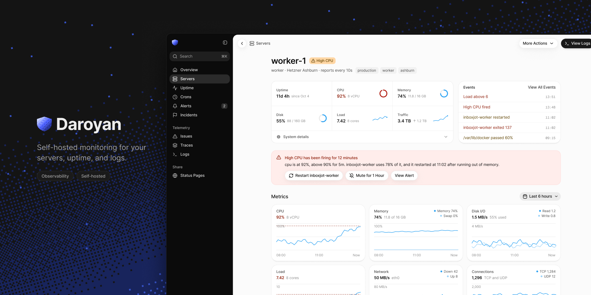
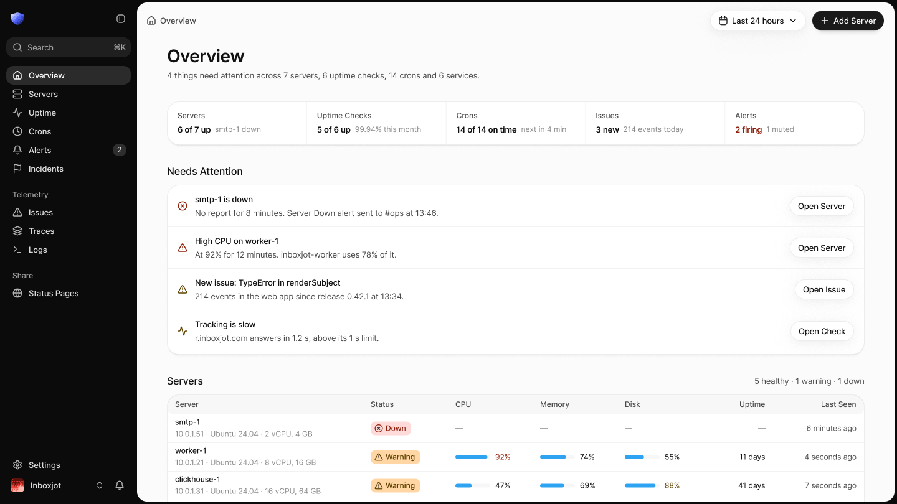
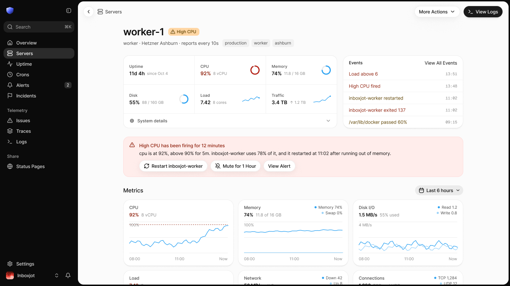
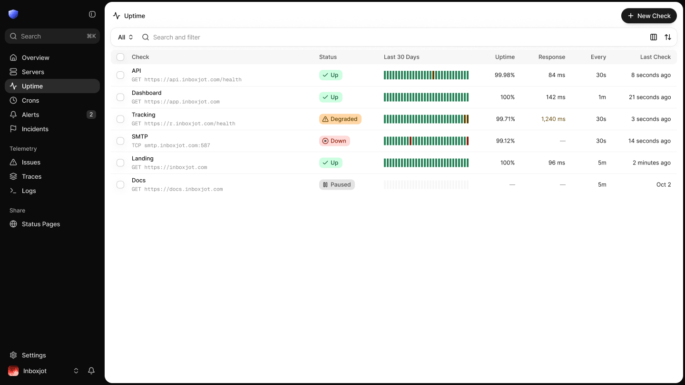
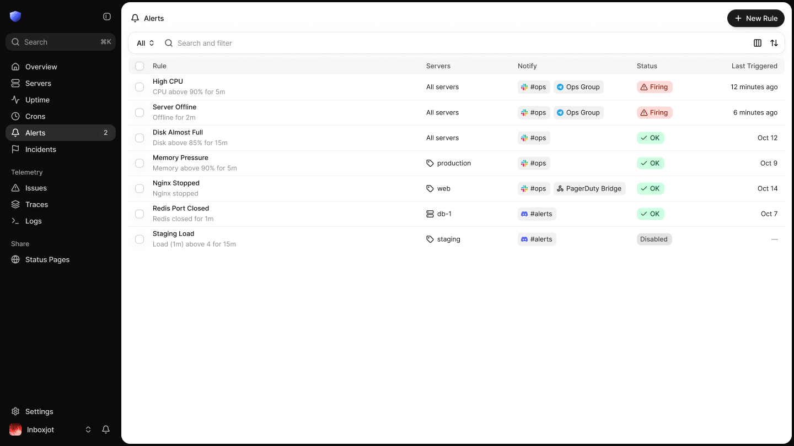
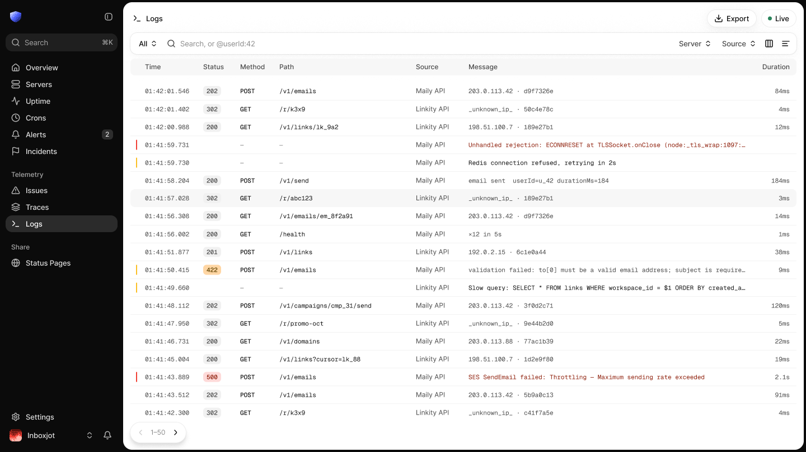
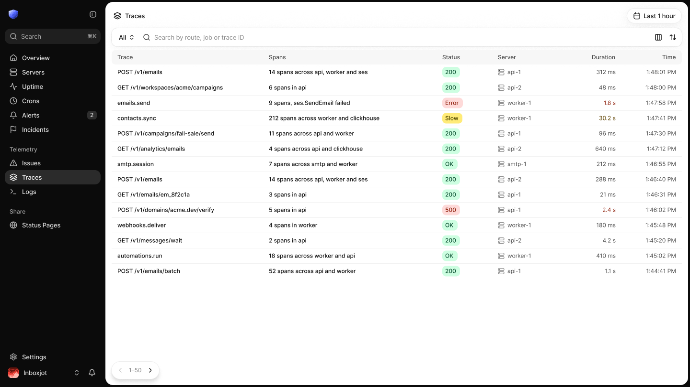
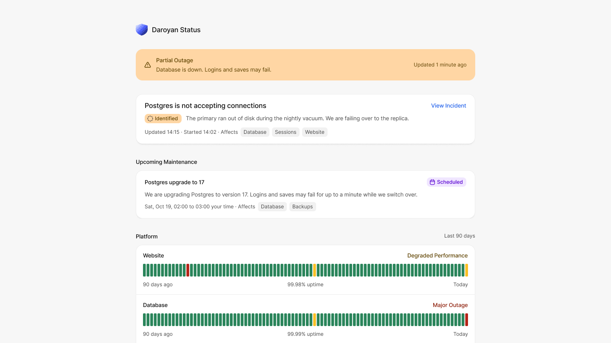

<p align="center">Self-hosted monitoring for your servers, uptime, <br />crons, logs and traces in a single binary.</p>

<p align="center">
  <a href="./LICENSE.md">
    
  </a>
  <a href="https://github.com/arikchakma/daroyan/releases/latest">
    
  </a>
  <a href="https://github.com/arikchakma/daroyan/pkgs/container/daroyan%2Fapi">
    
  </a>
  <a href="./DEPLOY.md">
    
  </a>
</p>

Daroyan watches your servers, uptime checks and cron jobs, collects logs, traces and errors, and alerts you in Slack, Discord, Telegram or a webhook when something breaks. It ships as one API binary with the dashboard built in, and stores everything in SQLite and DuckDB on local disk, so a single host is enough to run it.

### Quick Start

```sh
docker run -d -p 8900:8900 -v ./data:/app/data --env-file .env \
  ghcr.io/arikchakma/daroyan/api:latest
```

Set `APP_URL`, `GOOGLE_CLIENT_ID`, `GOOGLE_CLIENT_SECRET` and `ALLOWED_EMAILS` in `.env`, then open `APP_URL` and sign in with Google. See [DEPLOY.md](./DEPLOY.md) for the reverse proxy, the Google OAuth client and the agent install.





<table>
  <tr>
    <td></td>
    <td></td>
  </tr>
  <tr>
    <td></td>
    <td></td>
  </tr>
</table>



### What's in This Repo

- [`crates/daroyan-api`](./crates/daroyan-api) - The server. Serves the dashboard, the JSON API and public status pages.
- [`crates/daroyan-agent`](./crates/daroyan-agent) - The agent you install on each server to report metrics.
- [`crates/daroyan-core`](./crates/daroyan-core) - Shared logic: storage, alerts, uptime checks and integrations.
- [`crates/daroyan-protocol`](./crates/daroyan-protocol) - The messages the agent and the server exchange.
- [`crates/daroyan-migration`](./crates/daroyan-migration) - Database migrations.
- [`apps/web`](./apps/web) - The dashboard (React Router SPA).
- [`packages/client`](./packages/client) - Typed API client generated from the OpenAPI spec.

### Deploying

See [DEPLOY.md](./DEPLOY.md) to run Daroyan with Docker or as a plain binary.

### Contributing

Feel free to submit pull requests, create issues, or spread the word.

### License

[FSL-1.1-ALv2](./LICENSE.md) &copy; [Arik Chakma](https://x.com/imarikchakma)
